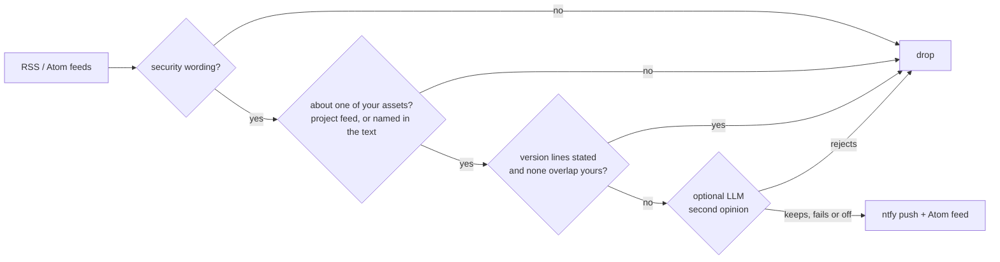

# mushirase

Push only the security notices that hit your stack: pre-announcements and early reports matched against your own inventory.

Dependabot and friends match published advisories (GHSA / OSV). They cannot see what comes before or outside them: "a critical PHP security release is scheduled for tomorrow", a Next.js security release program post, a supply-chain compromise written up on a blog hours before the advisory, or a runtime / managed service your manifests do not declare. mushirase reads those feeds, keeps only the items about something you run, and pushes them. A notification means "must read".

Status: prototype.

## How it works



The chart leaves out two exceptions listed below: runtimes outside their own feed need a version line, and supply-chain items skip the version check for libraries.

- Inventory: hand-written YAML for what no manifest declares, plus repository checkouts scanned for `package.json`, `composer.json`, `go.mod`, `requirements.txt`, `pyproject.toml`, `Dockerfile*`, `.mise.toml`, `.tool-versions` (direct dependencies only). Quote versions in YAML (`"8.10"`); an unquoted number is rejected because `8.10` would be read as `8.1`.
- Versions are npm semver ranges and are compared with [semver](https://github.com/npm/node-semver) (`intersects`). npm specs are kept as written; Composer and Python specs are rewritten (`~8.3` and `~=8.3` → `>=8.3 <9`, `~8.3.1` → `>=8.3.1 <8.4`, `==2.32.*` → `2.32.x`, `>=3.11,<3.13` → `>=3.11 <3.13`; `!=` and parts semver cannot express are dropped). Dockerfile tags, `.mise.toml` and `.tool-versions` give a line such as `8.3` (= `8.3.x`).
- Hand-written versions must be valid npm semver ranges (`"8.3"`, `"^15.0.0"`, `">=22 <24"`); anything else is rejected at load time.
- Project feeds (`product:` set) are about one product, so their items need not name it; version lines still apply. Spellings from different manifests are unified (`nodejs` = `node`, `golang` = `go`, `postgres` = `postgresql`, `react-dom` = `react`, `drupal` = `drupal/core`).
- General feeds need the item to name an asset. Ambiguous names are matched by how notices write them (`next` → `Next.js`, `go` → `Golang`, or `Go` followed by a version); plain names shorter than 4 characters are skipped. Aliases are case-insensitive except `React` and `Rails`; a capitalised name you write yourself (`Express`) keeps its case.
- Version lines are read only when written right after the name, optionally after the word "version(s)" (`PHP 8.4.16, 8.3.30, and 8.2.29`) and only in dotted form, so CVSS scores, years, dates and counts do not count (nor do bare majors like `Node.js 22` or suffixed builds like `8.3.30-1ubuntu1`). An item naming only other lines is dropped.
- Runtimes (PHP, Python, Node.js, PostgreSQL, ...) outside their own feed need a version line (overlapping the asset's, when it has one), because library notices name them in passing ("S3 Encryption Client for PHP").
- Supply-chain items (malicious / compromised) skip the line check for libraries: a manifest range like `^4.3` can resolve to the new malicious version.
- Items already seen are remembered per feed in a state file for 90 days (or `maxAgeDays` if longer); items older than `maxAgeDays` are ignored.

## Usage

```bash
bun install
bun run src/cli.ts scan ../my-repo ../other-repo > inventory.yaml   # see what a checkout declares
bun run src/cli.ts run -c examples/mushirase.yaml --dry-run --max-age 60   # what would have been pushed
bun run src/cli.ts run -c examples/mushirase.yaml                          # push and record
```

`run` exits 1 when a feed or a push fails; failed pushes are retried on the next run.

## Configuration

See `examples/mushirase.yaml` and `examples/stack.yaml`. Paths are relative to the config file.

| key | meaning |
|---|---|
| `inventory` | YAML files (`assets: [{name, version}]`) and/or repository checkouts |
| `feeds` | `{name, url, product?}` |
| `maxAgeDays` | ignore older items (default 7) |
| `llm` | `{url, model, apiKeyEnv?, reasoningEffort?}` for any OpenAI-compatible endpoint |
| `ntfy` | `{url, topic, tokenEnv?}` |
| `rss` | `{path, title?}`: an Atom feed of what was pushed (last 100) |
| `state` | state file (default `.mushirase/state.json`) |

The LLM stage is off by default. When it fails, the keyword hit is kept and marked, so an outage never hides a notice; an item it rejects is not recorded and is judged again on every run while it stays in the window (for items without a date, as long as the feed lists them). A small local model (qwen3.5:9b without thinking) dropped 8 of 13 must-read items in our trial, so do not enable it with a model you have not measured. Feed text goes into the prompt as is, so a crafted post can talk the model into rejecting itself.

Pushed messages name the matching assets and versions. On a public ntfy server, use an access-controlled topic (`tokenEnv`) or an unguessable topic name.

## Not yet

- Merging the same event seen in several feeds (a PHP pre-announcement also arrives via oss-security and AWS bulletins)
- Mailing-list-only pre-announcements (OpenSSL, Go, Django): needs a mail inbox reader
- Slack and email delivery
- Version ranges from lockfiles instead of manifest lines
- A GitHub Action (match in the user's CI) or a GitHub App (read the repository from the service)

## License

MIT
