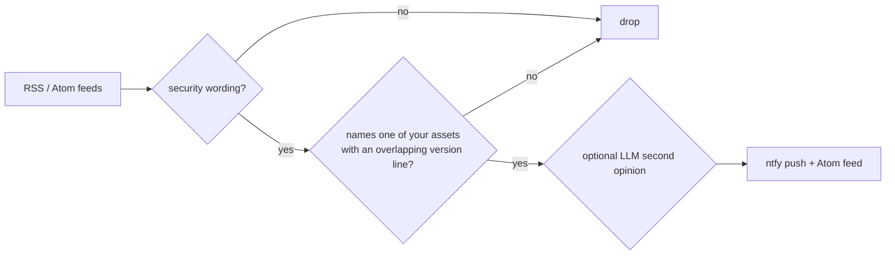

# mushirase

Push only the security notices that hit your stack: pre-announcements and early reports matched against your own inventory.

Dependabot and friends match published advisories (GHSA / OSV). They cannot see what comes before or outside them: "a critical PHP security release is scheduled for tomorrow", a Next.js security release program post, a supply-chain compromise written up on a blog hours before the advisory, or a runtime / managed service your manifests do not declare. mushirase reads those feeds, keeps only the items that name something you run, and pushes them. A notification means "must read".

Status: prototype.

## How it works



- Inventory: hand-written YAML for what no manifest declares, plus repository checkouts scanned for `package.json`, `composer.json`, `go.mod`, `requirements.txt`, `pyproject.toml`, `Dockerfile*`, `.mise.toml`, `.tool-versions` (direct dependencies only).
- Project feeds (`product:` set) are about one product, so every item concerns it and only the security wording is checked.
- General feeds need the item to name an asset. Ambiguous names are matched by how notices write them (`next` → `Next.js`, `go` → `Golang`); plain names shorter than 4 characters are skipped.
- Version lines are read only when written right after the name (`PHP 8.4.16 and 8.3.30`), so CVSS scores and dates do not count. An item naming other lines is dropped.
- Runtimes (PHP, Python, Node.js, PostgreSQL, ...) outside their own feed need an overlapping version line, because library notices name them in passing ("S3 Encryption Client for PHP").
- Supply-chain items (malicious / compromised) skip the line check for libraries: a manifest range like `^4.3` can resolve to the new malicious version.
- Items already seen are remembered in a state file; items older than `maxAgeDays` are ignored.

## Usage

```bash
bun install
bun run src/cli.ts scan ../my-repo ../other-repo > inventory.yaml   # see what a checkout declares
bun run src/cli.ts run -c examples/mushirase.yaml --dry-run --max-age 60   # what would have been pushed
bun run src/cli.ts run -c examples/mushirase.yaml                          # push and record
```

`run` exits 1 when a feed or a push fails; failed pushes are retried on the next run.

## Configuration

See `examples/mushirase.yaml` and `examples/stack.yaml`. Paths are relative to the config file.

| key | meaning |
|---|---|
| `inventory` | YAML files (`assets: [{name, version}]`) and/or repository checkouts |
| `feeds` | `{name, url, product?}` |
| `maxAgeDays` | ignore older items (default 7) |
| `llm` | `{url, model, apiKeyEnv?, reasoningEffort?}` for any OpenAI-compatible endpoint |
| `ntfy` | `{url, topic, tokenEnv?}` |
| `rss` | `{path, title?}`: an Atom feed of what was pushed (last 100) |
| `state` | state file (default `.mushirase/state.json`) |

The LLM stage is off by default. When it fails, the keyword hit is kept and marked, so an outage never hides a notice. A small local model (qwen3.5:9b without thinking) dropped 8 of 13 must-read items in our trial, so do not enable it with a model you have not measured.

## Not yet

- Merging the same event seen in several feeds (a PHP pre-announcement also arrives via oss-security and AWS bulletins)
- Mailing-list-only pre-announcements (OpenSSL, Go, Django): needs a mail inbox reader
- Slack and email delivery
- Version ranges from lockfiles instead of manifest lines
- A GitHub Action (match in the user's CI) or a GitHub App (read the repository from the service)

## License

MIT
